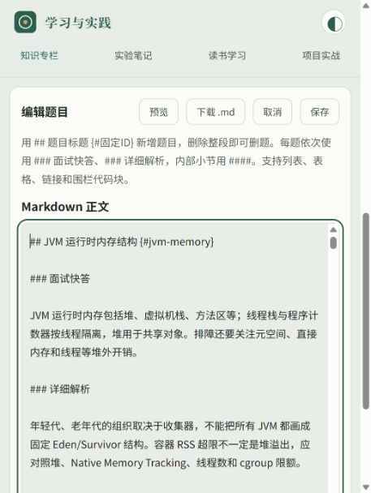

# 面试题整改记录

执行日期：2026-10-18。范围：网站 17 个面试专题；6 篇 LLM 实验笔记和读书手册保持独立。

362 道原题调整为 233 道：116 道合并到相关主题，13 道删除。逐题清单与目标 ID 见 [机器可读清单](interview-curation-20261018.json)。

## 筛选口径

以五年 Java 后端社会招聘为主线：保留并发与 JVM 排障、Spring 事务、MySQL 索引与一致性、缓存、可靠消息、服务治理、安全和可观测性。Python、AI/RAG、模型推理、前端及大数据保留为扩展方向；它们并非所有五年后端岗位的共同必考项。

实际招聘要求支持上述主线，但有限岗位样本不能推导行业题目频率。这里的合并和删除是结合本项目题库、岗位要求与内容重叠作出的编辑判断，不是声称掌握全市场统计。

参考的公开岗位材料：

- [北京农商银行社会招聘岗位与条件](https://www.bjrcb.com/resource/2026/02/60025438486954693.pdf)：研发岗位涉及 Java/Spring、数据库、中间件与工程交付。
- [茅台数科 2026 年社会招聘岗位表](https://www.moutaichina.com/mtgf/2026-04/24/25dae6b7b53d4a6682482f764eba595d/2026042418071183663.pdf)：不同经验岗位强调核心系统开发、架构演进与稳定性，部分岗位涉及云原生和 AI；不将高级岗位所有要求强加到五年候选人。

## 内容调整

所有保留题都重新编写“面试快答”和工程边界说明；详解整理有价值的原理、步骤、示例和表格，删除重复的第三套“面试回答”。重点重写了 volatile、JVM 内存、虚拟线程、线程池、事务可见性、隔离级别、Redis 锁与持久化、RocketMQ 延迟消息、LangGraph 恢复、OAuth2 和密码存储等易错解释。

合并保留核心知识而非拼接所有旧段落，例如：

| 原分散题 | 新归属 |
| --- | --- |
| 线程池参数、执行流程、Executors 风险 | 线程池核心参数与执行流程 |
| JVM 堆分代、运行时内存 | JVM 运行时内存结构 |
| JWT 两道重复题 | JWT 基本原理 |
| K8s Service/HPA 跨专题重复 | Docker/K8s 对应主题 |
| RAGAS、忠实度与模型裁判 | RAG 离线评测集与评价方法 |
| 父子块、切块重叠、模型与数据库选型重复内容 | 对应的设计与选型主题 |

删除 Python 单例/MRO、JVM/JDK/JRE 等入门术语独立背诵、打破类加载委派、零散语法题、Slurm 对比、特定框架简介和模型参数/型号背诵。通用概念仍在对应原理与工程题中说明；删除不表示这些知识对所有岗位都无价值。

技术核验资料（访问日期均为 2026-10-18；滚动文档应结合实际部署版本）：

- [Java 内存模型](https://docs.oracle.com/javase/specs/jls/se15/html/jls-17.html)：volatile 和 happens-before。
- [JDK 虚拟线程](https://docs.oracle.com/en/java/javase/26/core/virtual-threads.html)：虚拟线程、载体线程与版本边界。
- [CPython 自由线程](https://docs.python.org/3/howto/free-threading-python.html)：可选自由线程构建及扩展兼容性。
- [Spring 事务注解](https://docs.spring.io/spring-framework/reference/data-access/transaction/declarative/annotations.html)：代理、自调用、方法可见性与回滚。
- [MySQL 8.4 一致性读](https://dev.mysql.com/doc/refman/8.4/en/innodb-consistent-read.html)：快照视角与隔离级别。
- [Redis 分布式锁](https://redis.io/docs/latest/develop/clients/patterns/distributed-locks/)：异步复制、租约和互斥边界。
- [RocketMQ 定时消息](https://rocketmq.apache.org/docs/featureBehavior/02delaymessage/)：指定投递时间与版本约束。
- [OWASP 密码存储](https://cheatsheetseries.owasp.org/cheatsheets/Password_Storage_Cheat_Sheet.html)：成熟密码哈希、盐和算法升级。

## 文件与兼容

- 题库源文件为 `src/developer/*.md`，仍输出原来的 `.html` 地址。
- 题目 ID 保持稳定，合并题通过重定向表定位到新归属，已删除题的旧链接返回专题正文入口。
- 合并题学习进度通过迁移表映射。被删除题的旧本地记录不主动清空，也不计入当前题数。
- 编辑器只有 Markdown 正文、预览、下载、保存和取消。草稿仍支持多标签页独立保存与冲突保护；旧 HTML 草稿保留下载入口。
- 原 HTML 正文在本机 `.local-backups/before-markdown-20261018/` 备份，备份不进入 Git 且不会被开发服务公开。

## 验证

本次最终执行结果：

- `npm test`：先构建成功，随后 27 项回归测试全部通过。覆盖全部题库的浏览器渲染一致性、Markdown 结构与安全转义、编辑草稿、版本冲突、真实 HTTP 保存、备份、索引更新、导航与进度迁移。
- `node scripts/check.js`：26 个页面的链接、锚点、ID、导航、旧题重定向及索引一致性检查通过。
- `git diff --check`：未发现空白错误；Git 提示 Windows 行尾转换属于仓库现有设置。
- 实际浏览器验证 Java 专题的 32 道题完整预览、保存后重新进入阅读页；控制台无新增错误。编辑器打开后定位在文档开头。
- 首页“继续学习”兼容合并前 ID；合并题以最新时间选择进度，当前题目状态键不指向已删除别名。
- 未对所有教学片段逐一执行编译或运行；它们是解释与示例，生产使用仍需结合目标版本验证。

